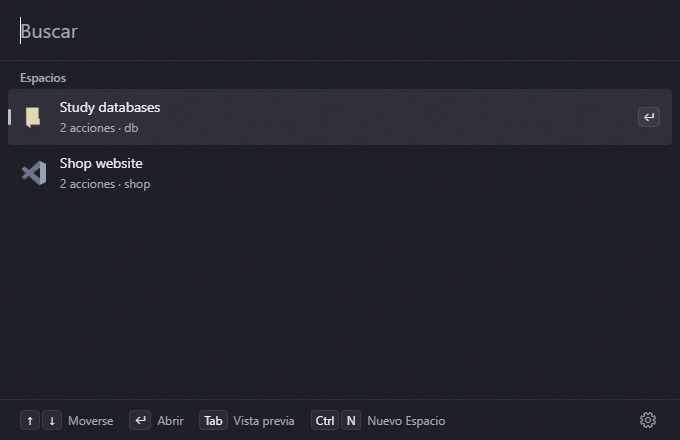
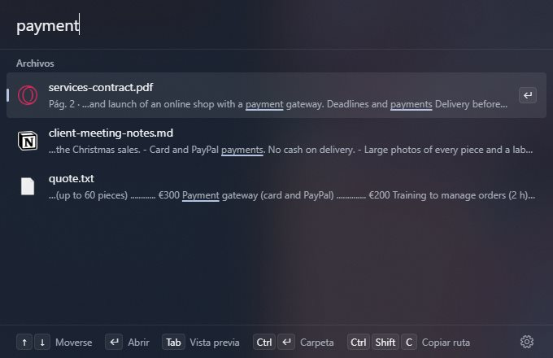
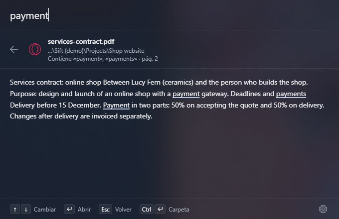
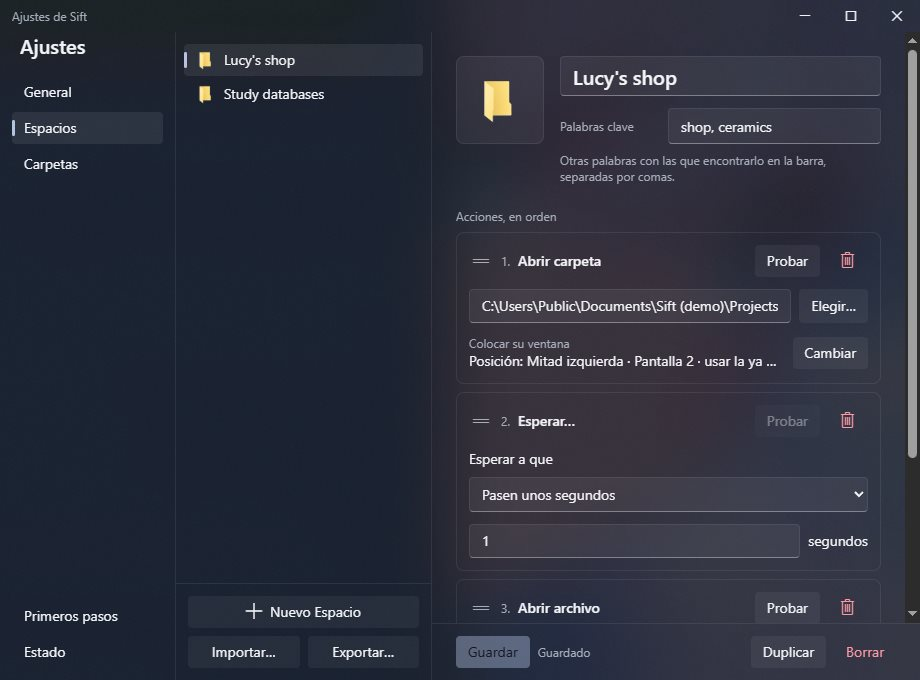

[Español](README.md) | **English**

# Sift

**Sift is a launcher and search bar for Windows that finds your files by what they are about, not just by their names, and nothing ever leaves your PC.**

Press `Alt+Space` from any app, type what you are looking for and Enter does the rest. With a **Space**, a single word opens everything you use for a task: folders, files, websites, apps and commands, each one in its place on the screen.

> Sift's interface is in Spanish for now. An English translation is on the [backlog](PLAN.md).

## What it does

- **Searches by name, by content and by meaning.** "databases" also brings up related files even if they never use that word. It reads text and notes, code, PDF, Word and PowerPoint; images, videos and spreadsheets are found by name. Accents and typos don't matter.

  

- **Tells you why each result shows up.** Press Tab to see the matching passage, with your search underlined, without leaving the bar.

  

- **Spaces: one name and everything opens.** A Space groups folders, files, websites, apps and commands, and can wait for something to be ready (a local website, a service) before going on. Each window can go to a half, a third or a quarter of the screen you choose.

  

- **PDFs open on the matching page.** If what you are looking for is on page 37, the PDF opens on page 37.
- **Quick filters.** "pdf budget" searches only your PDFs. Backspace removes the filter.
- **What you use comes first.** Files you open often and recently move up the results.
- **Keyboard first**, following Windows' light or dark theme and accent color (or the theme you pick in Settings).

## Installation

1. Download `Sift_<version>_x64-setup.exe` from the [Releases page](https://github.com/dariodmr14/Sift/releases/latest).
2. Run it. It installs for your user only, with no administrator rights.
3. **Windows will warn you that the program is not signed** ("Windows protected your PC", SmartScreen). Click "More info" and then "Run anyway". The warning appears because code signing costs money, and Sift is not signed yet.
4. A welcome screen opens at the end: choose the folders you want to search and create your first Space. Before downloading the model for searching by meaning (about 135 MB, once), it asks for your permission.
5. From then on, `Alt+Space` opens the bar. You can change the shortcut in Ajustes (Settings).

**Requirements:** Windows 10 or 11, 64-bit. Sift uses WebView2, which comes with Windows 11 and almost always with Windows 10. If it is missing, the installer installs it (this needs an internet connection at that moment).

**Updates:** on startup, Sift checks whether there is a new version. If there is, it **always asks** before downloading and installing it, and only installs it if it carries Sift's signature. You can turn it off in Ajustes (Settings) → General, «Buscar actualizaciones al arrancar» (check for updates on startup).

**Uninstall:** Windows Settings → Apps → Sift → Uninstall. If you tick «Eliminar los datos de aplicación» (delete the application data), your index is deleted too; otherwise it stays in `%APPDATA%\dev.sift.app` in case you install it again.

## Privacy

Sift runs entirely on your PC. Your files, the index and what you search for never leave your computer.

- **The only download** is the model for searching by meaning, once and only if you say yes. Its fingerprint is pinned and checked before use. The PDF library is already in the installer.
- **The only connection made without asking** is checking for a new version on startup: Sift fetches a small file from GitHub with the latest version number, sending nothing of yours. You can turn it off in Settings.
- **No telemetry:** Sift sends no usage data anywhere.
- **The app's logs never store** what you search for or the content of your files.
- **Nothing runs without asking:** a command in a Space, or a file that can run a program (`.bat`, `.lnk`…), asks first in a Windows dialog, not one drawn by the app.

## Numbers

These come from the [1.0 audit](docs/auditoria-1.0.md) (November 2026, in Spanish): Windows 10, an optimized build like the release one and folders of generated files. It explains how each number was measured.

| What | Target | Result |
|---|---|---|
| Search with **100,000** generated files (322,639 passages), p95 | < 50 ms | 14.9 ms |
| Search while preparing search by meaning, worst p95 | < 50 ms | 37 ms |
| Sift's memory when idle | < 100 MB | 55 MB, plus ~340 MB for WebView2, the Windows web engine behind the window |
| 3 hours in a row searching, opening Spaces and changing files | no leaks or errors | 0 errors; memory does not grow |
| Hard kills halfway through indexing | nothing lost | Picks up where it left off |

How well each way of searching finds things is measured with [`eval/`](eval/README.md): 34 real searches with their expected results.

## How it was built

I came up with Sift, designed it and directed it; most of the code was written by Claude Code (Anthropic's coding assistant) following my plan. This is how the work was split:

- **What I did:** the idea and what the app is for; the phased plan with what each phase had to deliver; the priorities and the product and design decisions, choosing among the options that came up; reviewing and understanding every change before accepting it; and using Sift every day to find what was broken or unnecessary ([FEEDBACK.md](FEEDBACK.md)).
- **What Claude did:** writing most of the code and the tests from that plan, proposing alternatives with their pros and cons, measuring (benchmarks and the `eval/` evaluation) and writing the decisions down in the [ADRs](docs/adr/).

Every change went through its own branch and PR, with the local CI green and my approval before merging.

That is why Claude shows up on GitHub among the repository's contributors: in the first pull requests, Claude Code signed the commits as co-author, and GitHub keeps that signature on the merged PRs.

### Under the hood

- **Tauri 2** (Rust and WebView2) with the interface in React, TypeScript and Tailwind. Types between Rust and TypeScript are generated.
- **SQLite** stores everything; **Tantivy** searches by words and **usearch** (HNSW) by vectors. Everything derived can be rebuilt from SQLite.
- **Search by meaning** with `multilingual-e5-small` on ONNX Runtime. Both searches are combined (Reciprocal Rank Fusion), then what you use most moves up.
- **PDF** with PDFium, at a pinned version and fingerprint.
- **Design:** the [Vidrio](docs/design-system.md) system, with a test that forbids stray colors and another that requires 4.5:1 text contrast on the glass over any desktop background.

### Learn more (in Spanish)

- [Lessons learned](docs/aprendido.md), phase by phase.
- [Architecture decisions](docs/adr/) (ADRs), starting with [0001](docs/adr/0001-tauri-y-almacenamiento.md).
- [The 1.0 audit](docs/auditoria-1.0.md): what was fixed before release and the stress tests.
- [The plan](PLAN.md), with the phases and what is left.
- [Building and developing it](docs/desarrollo.md), with the measurements of each phase. CI runs locally with `scripts/ci.ps1`.

## Credits

The visual polish was done with [unslop](https://github.com/heydamir/unslop), a guide to strip the AI-generated look from an interface. unslop was created by Damir Sokolovsky ([@heydamir](https://x.com/heydamir)), who started the Unslopping series on X. It is licensed under [CC BY 4.0](https://creativecommons.org/licenses/by/4.0/), so keep this credit in any copy or adaptation. The audit and the direction that came out of it are in [docs/proceso/unslop-direccion.md](docs/proceso/unslop-direccion.md) (in Spanish).

## License

**All rights reserved.** The code is public so that it can be read and studied, but it is not open source.

- **You may** read the code and the documentation, and install and use the versions published in Releases.
- **You may not**, without written permission, copy, modify or redistribute it, or use parts of it in other projects.

It is provided as is, without warranty. Third-party components (dependencies, PDFium, the embedding model) keep their own licenses. The full text, in Spanish and English, is in [LICENSE](LICENSE).
