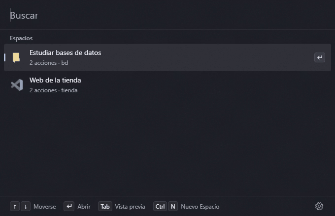
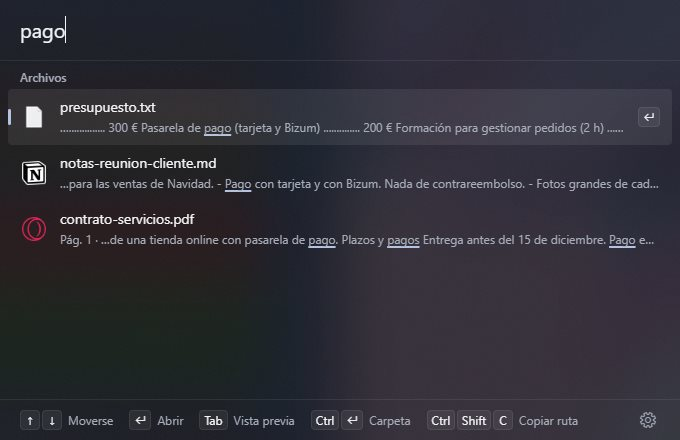
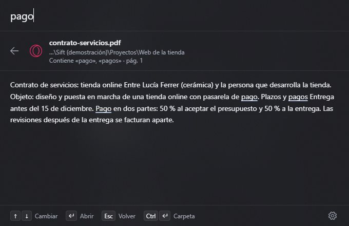
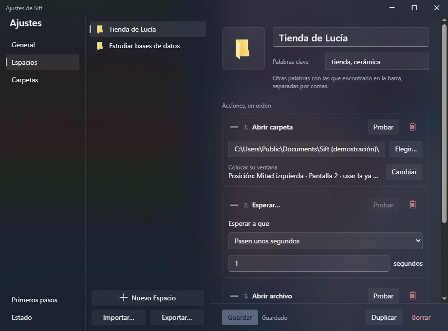

**Español** | [English](README.en.md)

# Sift

**Sift es un lanzador y buscador para Windows que encuentra tus archivos por lo que tratan, no solo por cómo se llaman, sin que nada salga de tu PC.**

Pulsas `Alt+Espacio` desde cualquier app, escribes lo que buscas y Enter hace el resto. Con un **Espacio**, una sola palabra abre todo lo que usas para una tarea: carpetas, archivos, webs, apps y comandos, cada uno en su sitio de la pantalla.

## Qué hace

- **Busca por nombre, por contenido y por significado.** «bases de datos» trae también los archivos relacionados aunque no usen esas palabras. Lee textos y notas, código, PDF, Word y PowerPoint; las imágenes, los vídeos y las hojas de cálculo, por su nombre. No le importan las tildes ni las erratas.

  

- **Te dice por qué sale cada resultado.** Pulsa Tab y ves el fragmento que encaja, con lo que buscabas subrayado, sin salir de la barra.

  

- **Espacios: un nombre y todo se abre.** Un Espacio junta carpetas, archivos, webs, apps y comandos, y puede esperar a que algo esté listo (una web local, un servicio) antes de seguir. Cada ventana puede ir a una mitad, un tercio o un cuarto de la pantalla que elijas.

  

- **Los PDF se abren en la página que encaja.** Si lo que buscas está en la página 37, el PDF se abre en la 37.
- **Filtros rápidos.** «pdf presupuesto» busca solo en los PDF. Retroceso quita el filtro.
- **Lo que usas, primero.** Lo que abres a menudo y hace poco sube en los resultados.
- **Se maneja con el teclado** y sigue el tema claro u oscuro y el color de acento de Windows.

## Instalación

1. Descarga `Sift_<versión>_x64-setup.exe` de la [página de Releases](https://github.com/dariodmr14/Sift/releases/latest).
2. Ejecútalo. Se instala solo para tu usuario, sin pedir permisos de administrador.
3. **Windows avisará de que el programa no está firmado** («Windows protegió su PC», SmartScreen). Pulsa «Más información» y después «Ejecutar de todas formas». El aviso sale porque firmar un programa cuesta dinero, y Sift todavía no lo está.
4. Al terminar se abre una bienvenida: elige las carpetas donde quieres buscar y crea tu primer Espacio. Antes de descargar el modelo de la búsqueda por significado (unos 135 MB, una sola vez), te pide permiso.
5. Desde entonces, `Alt+Espacio` abre la barra. El atajo se puede cambiar en Ajustes.

**Requisitos:** Windows 10 u 11 de 64 bits. Sift usa WebView2, que viene con Windows 11 y casi siempre con Windows 10. Si falta, el instalador lo instala (necesita internet en ese momento).

**Actualizaciones:** al arrancar, Sift mira si hay una versión nueva. Si la hay, **pregunta siempre** antes de descargarla e instalarla, y solo la instala si su firma es la de Sift. Se puede desactivar en Ajustes → General, «Buscar actualizaciones al arrancar».

**Desinstalar:** Configuración de Windows → Aplicaciones → Sift → Desinstalar. Si marcas «Eliminar los datos de aplicación», se borra también tu índice; si no, se queda en `%APPDATA%\dev.sift.app` por si vuelves a instalarlo.

## Privacidad

Sift funciona entero en tu PC. Tus archivos, el índice y lo que buscas no salen del ordenador.

- **Lo único que se descarga** es el modelo de búsqueda por significado, una vez y solo si dices que sí. Su huella está fijada y se comprueba antes de usarlo. La librería que lee los PDF ya viene en el instalador.
- **La única conexión sin preguntar** es mirar si hay una versión nueva al arrancar: se pide a GitHub un archivo pequeño con el número de la última versión, sin enviar nada tuyo. Se puede desactivar en Ajustes.
- **Sin telemetría:** Sift no envía datos de uso a ningún sitio.
- **Los registros de la app no guardan** lo que buscas ni el contenido de tus archivos.
- **Nada se ejecuta sin preguntar:** un comando de un Espacio, o un archivo que pueda ejecutar un programa (`.bat`, `.lnk`…), pide permiso antes en un diálogo de Windows, no de la app.

## Cifras

Son las de la [auditoría de la 1.0](docs/auditoria-1.0.md) (noviembre de 2026): Windows 10, una compilación optimizada como la de release y carpetas de archivos inventados. Allí está cómo se midió cada cosa.

| Qué | Objetivo | Resultado |
|---|---|---|
| Buscar, con **100 000 archivos** inventados (322 639 fragmentos), p95 | < 50 ms | 14,9 ms |
| Buscar mientras prepara la búsqueda por significado, peor p95 | < 50 ms | 37 ms |
| Memoria de Sift en reposo | < 100 MB | 55 MB, más ~340 MB de WebView2, el motor web de Windows que usa la ventana |
| 3 horas seguidas buscando, abriendo Espacios y cambiando archivos | sin fugas ni errores | 0 errores; la memoria no crece |
| Cierres bruscos a mitad de indexado | sin perder nada | Sigue donde se quedó |

Cuánto acierta cada forma de buscar se mide con [`eval/`](eval/README.md), 34 búsquedas reales con sus resultados esperados.

## Cómo se ha construido

Sift lo he ideado, diseñado y dirigido yo; la mayor parte del código la ha escrito Claude Code (el asistente de programación de Anthropic) siguiendo mi plan. El reparto ha sido este:

- **Lo que he hecho yo:** la idea y para qué sirve la app; el plan por fases con lo que tenía que cumplir cada una; las prioridades y las decisiones de producto y de diseño, eligiendo entre las opciones que salían; revisar y entender cada cambio antes de aceptarlo; y usar Sift a diario para encontrar lo que fallaba o sobraba ([FEEDBACK.md](FEEDBACK.md)).
- **Lo que ha hecho Claude:** escribir la mayor parte del código y de los tests a partir de ese plan, proponer alternativas con sus pros y contras, medir (benchmarks y la evaluación de `eval/`) y dejar por escrito las decisiones en los [ADR](docs/adr/).

Cada cambio ha ido en su rama y su PR, con la CI local en verde y con mi visto bueno antes de fusionarse.

Por eso Claude aparece en GitHub entre quienes han contribuido al repositorio: en los primeros pull requests, Claude Code firmaba los commits como coautor, y GitHub conserva esa firma en los PR ya fusionados.

### Por dentro

- **Tauri 2** (Rust y WebView2) con la interfaz en React, TypeScript y Tailwind. Los tipos entre Rust y TypeScript se generan solos.
- **SQLite** guarda todo; **Tantivy** busca por palabras y **usearch** (HNSW) por vectores. Lo derivado se puede reconstruir desde SQLite.
- **Búsqueda por significado** con `multilingual-e5-small` en ONNX Runtime. Las dos búsquedas se combinan (Reciprocal Rank Fusion) y luego sube lo que usas más.
- **PDF** con PDFium, en una versión y con una huella fijadas.
- **Diseño:** el sistema [Vidrio](docs/design-system.md), con un test que impide colores sueltos.

### Para saber más

- [Lo aprendido](docs/aprendido.md), fase a fase.
- [Las decisiones de arquitectura](docs/adr/) (ADR), empezando por la [0001](docs/adr/0001-tauri-y-almacenamiento.md).
- [La auditoría de la 1.0](docs/auditoria-1.0.md): lo que se arregló antes de publicar y las pruebas de aguante.
- [El plan](PLAN.md), con las fases y lo que queda.
- [Compilarlo y desarrollar](docs/desarrollo.md), con las mediciones de cada fase. La CI se ejecuta en local con `scripts/ci.ps1`.

## Créditos

El pulido visual se hizo con [unslop](https://github.com/heydamir/unslop), una guía para quitarle a una interfaz el aspecto de hecha con IA. unslop was created by Damir Sokolovsky ([@heydamir](https://x.com/heydamir)), who started the Unslopping series on X. It is licensed under [CC BY 4.0](https://creativecommons.org/licenses/by/4.0/), so keep this credit in any copy or adaptation. La auditoría y la dirección que salieron de ella están en [docs/proceso/unslop-direccion.md](docs/proceso/unslop-direccion.md).

## Licencia

**Todos los derechos reservados.** El código es público para que se pueda ver y estudiar, pero no es de código abierto.

- **Sí puedes** leer el código y la documentación, e instalar y usar las versiones publicadas en Releases.
- **No puedes**, sin permiso escrito, copiarlo, modificarlo, redistribuirlo ni usar partes en otros proyectos.

Se ofrece tal cual, sin garantías. Los componentes de terceros (dependencias, PDFium, el modelo de embeddings) conservan sus propias licencias. El texto completo, en español e inglés, está en [LICENSE](LICENSE).
