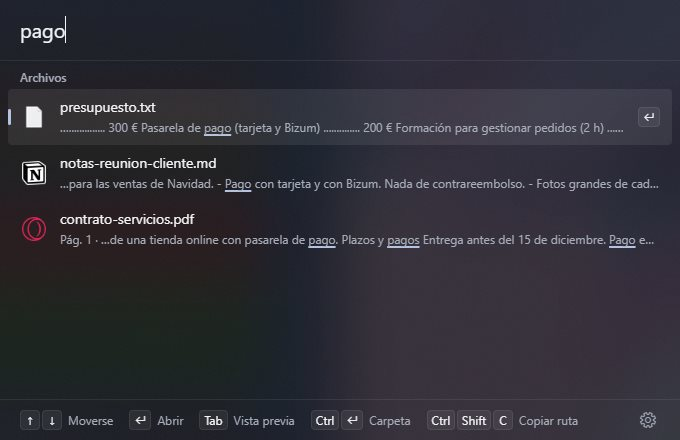
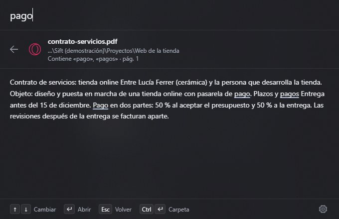
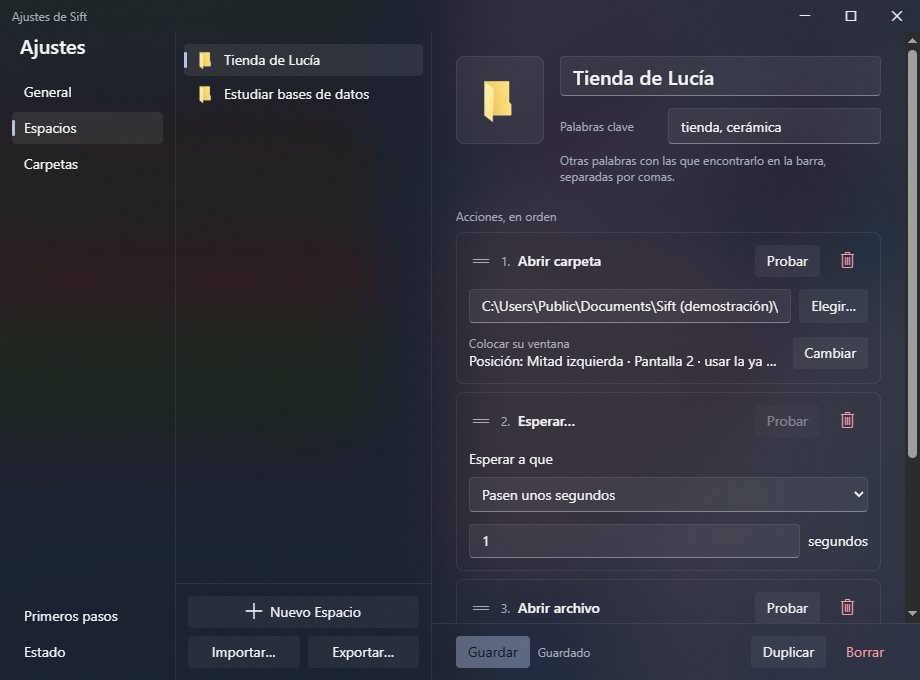

# Sift

**Sift es un lanzador y buscador para Windows.** Encuentra tus archivos por su nombre, por lo que dicen y por lo que tratan. Y abre de una vez todo lo que usas para una tarea. Nada de eso sale de tu PC.

<!-- PENDIENTE: GIF de 10 s abriendo un Espacio -->

Pulsas `Alt+Espacio`, escribes lo que buscas y Enter hace el resto.

## Qué hace

- **Busca por significado.** Si escribes «bases de datos», también salen los archivos relacionados, aunque no usen esas palabras. Se puede desactivar en Ajustes.
- **Te dice por qué sale cada resultado.** Pulsa Tab y ves un fragmento del archivo con lo que encaja subrayado, sin salir de la barra.

  

- **Espacios: un nombre y todo se abre.** Un Espacio agrupa carpetas, archivos, webs, apps y comandos. Escribe su nombre y pulsa Enter. Cada cosa puede ir a una mitad, un tercio o un cuarto de la pantalla.

  

- **Filtros rápidos.** «pdf presupuesto» busca solo PDF con esa palabra. Retroceso quita el filtro.
- **Los PDF se abren en la página que encaja.** Si la búsqueda está en la página 37, el PDF se abre en la 37.
- **Lo que usas, primero.** Lo que abres a menudo y hace poco sube en los resultados.

## Instalación

<!-- PENDIENTE: enlace de descarga del instalador en GitHub Releases -->

1. Descarga el instalador desde la página de Releases de Sift.
2. Ejecútalo. Se instala solo para tu usuario, sin pedir permisos de administrador.
3. Windows puede avisar de que el programa no está firmado. Pulsa «Más información» y después «Ejecutar de todas formas». Firmar Sift tiene un coste, y todavía no está decidido.
4. Pulsa `Alt+Espacio` desde cualquier app para abrir la barra. Se puede cambiar el atajo.
5. La primera vez aparece una bienvenida. Te pide elegir las carpetas que quieres buscar y crear tu primer Espacio. Antes de descargar el modelo de búsqueda por significado (unos 135 MB, una sola vez), te pide permiso.

Si quieres que Sift arranque al iniciar sesión, actívalo en Ajustes → General.

**Requisitos:** Windows 10 u 11 de 64 bits. Sift usa WebView2, que ya viene con los dos.
<!-- PENDIENTE: confirmar los requisitos de Windows; el README actual no los fija -->

Para desinstalarlo: Configuración de Windows → Aplicaciones → Sift → Desinstalar. Tus datos se quedan en `%APPDATA%\dev.sift.app`, por si vuelves a instalarlo. Si quieres borrarlos también, borra esa carpeta.

<!-- PENDIENTE: explicar cómo llegan las actualizaciones (la actualización automática está en la Fase 8, sin hacer) -->

## Privacidad

Sift funciona en tu PC. Tu índice, tus archivos y lo que buscas no salen del ordenador.

- **Lo único que se descarga:** el modelo de búsqueda por significado (unos 135 MB), una sola vez y solo si dices que sí en la bienvenida o en Ajustes. Su huella está fijada y se comprueba. La librería que lee los PDF (PDFium) ya viene dentro del instalador.
- **Sin telemetría.** Sift no envía datos de uso a ningún sitio.
- **Sin registro de lo que buscas.** Los registros de la app no guardan búsquedas ni el contenido de tus archivos.

## Métricas

Medidas en Windows 10, con el PC en reposo y una versión de release. La búsqueda se midió en un ordenador con procesador Intel i7-7700K.

| Qué se mide | Objetivo | Resultado |
|---|---|---|
| Tiempo desde `Alt+Espacio` hasta ver la barra (habitual) | menos de 100 ms | 37 ms |
| Tiempo desde `Alt+Espacio` hasta ver la barra (casi siempre, 95 de cada 100) | menos de 100 ms | 45 ms |
| Búsqueda completa, en una carpeta real de 12.871 archivos (habitual / casi siempre) | menos de 50 ms | 10,3 ms / 17,5 ms |

Calidad de los resultados, con 34 búsquedas reales sobre esa misma carpeta (las consultas están en [eval/](../../eval/README.md)):

| Forma de buscar | Acierto en los 10 primeros | Lo arriba que sale lo primero que vale (1 es lo mejor) |
|---|---|---|
| Solo por palabras | 0,62 | 0,53 |
| Solo por significado | 0,58 | 0,46 |
| **Sift (las dos combinadas)** | **0,75** | **0,66** |

<!-- PENDIENTE: revisar si estas cifras siguen siendo las finales antes de publicar -->

## Cómo se ha construido

<!-- PENDIENTE: este párrafo habla en tu nombre (primera persona); revísalo y cámbialo a tu manera -->
Sift lo he ideado, diseñado y dirigido yo. La mayor parte del código la ha escrito Claude Code, el asistente de programación de Anthropic, siguiendo mi plan. Yo he decidido las prioridades y el producto, he revisado cada cambio antes de aceptarlo y he usado Sift a diario para encontrar lo que fallaba.

Para la gente técnica, el resumen es este:

- **Stack.** Tauri 2 (Rust y WebView2) con la interfaz en React, TypeScript, Vite y Tailwind 4. Los tipos entre Rust y TypeScript se generan con tauri-specta.
- **Almacenamiento.** SQLite es la fuente de verdad. Tantivy se encarga de la búsqueda por palabras y usearch (HNSW) de los vectores. Todo lo derivado se puede reconstruir desde SQLite.
- **Búsqueda por significado.** `multilingual-e5-small` en ONNX Runtime, descargado una vez con su hash comprobado.
- **Búsqueda híbrida.** La búsqueda por palabras y la semántica corren en paralelo y se fusionan con Reciprocal Rank Fusion (RRF). Después, la frecencia (lo que abres a menudo y hace poco) reordena el resultado.
- **Lectura de PDF.** PDFium, con versión y huella fijadas.
- **Diseño.** El sistema de diseño Vidrio, con tokens y un test que impide colores literales. Ver la [guía](../design-system.md).
- **Decisiones.** Cada decisión importante está en un [ADR](../adr/). Empieza por la [0001](../adr/0001-tauri-y-almacenamiento.md).
- **Medición.** Cada cambio en el ranking se mide con `eval/`. Los benchmarks son reproducibles con `criterion`.
- **Calidad.** Comprobaciones en local con `scripts/ci.ps1` (formato, lint, tests, auditoría y build) antes de cada fusión.
- **Cómo se trabaja.** Un modelo principal coordina y revisa. Un subagente implementa cuando el diseño está decidido, y otro hace las tareas mecánicas. Cada cambio va en su rama y su PR.

Lo que más me ha servido, fase a fase, está en [docs/aprendido.md](../aprendido.md). En resumen:

- Medir antes de decidir. El modelo, los pesos de la búsqueda y lo que la hacía lenta salieron de medir, y casi nunca era lo que parecía.
- La seguridad la impone Rust, no la interfaz. Lo que ejecuta un Espacio se aprueba en Rust y con el comando exacto.
- Windows tiene sus propias reglas. Conviene descubrirlas con pruebas pequeñas y aisladas.
- Un sistema de diseño solo se mantiene si un test lo vigila.

Para compilarlo y usarlo a diario, ver [docs/instalar.md](../instalar.md) y la sección de desarrollo del [README](../../README.md#desarrollo).

## Créditos

- El pulido visual de la Fase 7 se hizo con [unslop](https://github.com/heydamir/unslop), una guía para quitarle a una interfaz el aspecto de hecha con IA. unslop was created by Damir Sokolovsky ([@heydamir](https://x.com/heydamir)), who started the Unslopping series on X. It is licensed under [CC BY 4.0](https://creativecommons.org/licenses/by/4.0/), so keep this credit in any copy or adaptation. La auditoría y la dirección que salieron de ella están en [docs/unslop-direccion.md](../unslop-direccion.md).

## Licencia
**Todos los derechos reservados.** El código es público para que se pueda ver y estudiar, pero no es de código abierto: sin permiso no se puede copiar, modificar ni redistribuir. Sí puedes instalar las versiones publicadas y usarlas. Los componentes de terceros (dependencias, PDFium, el modelo de embeddings) conservan sus propias licencias. Detalles en [LICENSE](../../LICENSE).
