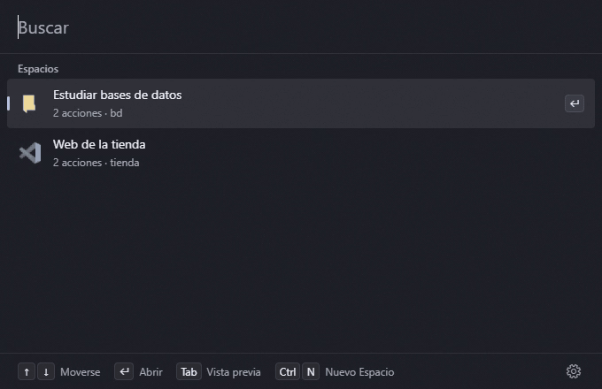
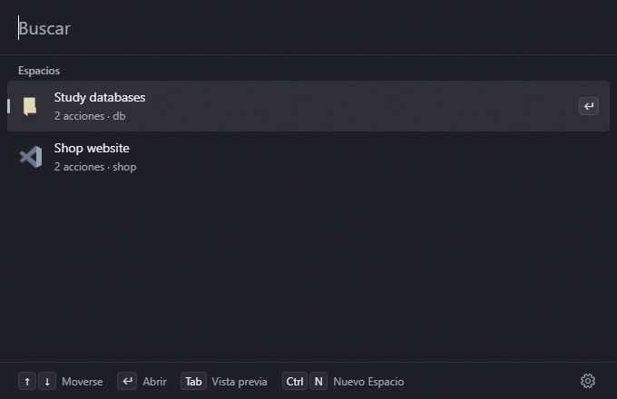

**Sift 1.0.0**: la primera versión estable. *English below.*

Sift es un lanzador y buscador para Windows que encuentra tus archivos por lo que tratan, no solo por cómo se llaman, sin que nada salga de tu PC. `Alt+Espacio` desde cualquier app.

## Instalar

1. Descarga **`Sift_1.0.0_x64-setup.exe`** (abajo, en *Assets*).
2. Ejecútalo. Se instala solo para tu usuario, sin permisos de administrador.
3. Windows avisará de que no reconoce la aplicación (SmartScreen): «Más información» → «Ejecutar de todas formas». Avisa porque el instalador no lleva un certificado de firma de Windows, que es de pago. Las actualizaciones son otra cosa: van firmadas con la clave de Sift, y Sift solo instala las que llevan esa firma.
4. La primera vez, una introducción te guía en un minuto.

Windows 10 u 11 de 64 bits. La interfaz está en español.

Para comprobar la descarga: `Get-FileHash .\Sift_1.0.0_x64-setup.exe` tiene que dar lo que dice `SHA256SUMS.txt`.

## Qué trae

- Búsqueda por nombre, por contenido y por significado, con la vista previa de por qué sale cada resultado (Tab).
- Espacios: una palabra abre carpetas, archivos, webs, apps y comandos, cada ventana en su zona de la pantalla.
- Los PDF se abren en la página que encaja; filtros rápidos («pdf presupuesto»); lo que usas, primero.
- Todo local. Lo único que se descarga es el modelo de búsqueda por significado (~135 MB), una vez y con tu permiso.
- Nada se ejecuta sin preguntar: los comandos y los archivos que pueden ejecutar algo piden permiso en un diálogo de Windows.
- Actualizaciones firmadas: al arrancar mira si hay una versión nueva y **pregunta siempre** antes de descargarla e instalarla. Se puede desactivar en Ajustes → General.

Antes de publicarla se probó con 100 000 archivos, con cierres bruscos y 3 horas seguidas: [auditoría de la 1.0](https://github.com/dariodmr14/Sift/blob/main/docs/auditoria-1.0.md).

## Desinstalar

Configuración de Windows → Aplicaciones → Sift → Desinstalar. Tus archivos no se tocan. Lo que guarda Sift (el índice y los ajustes) se borra solo si marcas «Eliminar los datos de aplicación».

## ¿Un fallo o una idea?

Abre un Issue: <https://github.com/dariodmr14/Sift/issues>

---

**Sift 1.0.0**: the first stable release.

Sift is a launcher and search bar for Windows that finds your files by what they are about, not just by their names, and nothing ever leaves your PC. `Alt+Space` from any app.

## Install

1. Download **`Sift_1.0.0_x64-setup.exe`** (below, under *Assets*).
2. Run it. It installs for your user only, with no administrator rights.
3. Windows will warn that it doesn't recognize the app (SmartScreen): "More info" → "Run anyway". It warns because the installer has no Windows code-signing certificate, which costs money. Updates are a different matter: they are signed with Sift's own key, and Sift only installs the ones that carry that signature.
4. The first time, an introduction walks you through it in a minute.

Windows 10 or 11, 64-bit. The interface is in Spanish.

To check the download: `Get-FileHash .\Sift_1.0.0_x64-setup.exe` must match `SHA256SUMS.txt`.

## What's in it

- Search by name, by content and by meaning, with a preview of why each result shows up (Tab).
- Spaces: one word opens folders, files, websites, apps and commands, each window in its zone of the screen.
- PDFs open on the matching page; quick filters ("pdf budget"); what you use comes first.
- Everything local. The only download is the model for searching by meaning (~135 MB), once and with your permission.
- Nothing runs without asking: commands, and files that can run something, ask first in a Windows dialog.
- Signed updates: on startup it checks for a new version and **always asks** before downloading and installing it. You can turn it off in Ajustes (Settings) → General, «Buscar actualizaciones al arrancar».

Before release it was tested with 100,000 files, forced shutdowns and 3 hours in a row: [1.0 audit](https://github.com/dariodmr14/Sift/blob/main/docs/auditoria-1.0.md) (in Spanish).

## Uninstall

Windows Settings → Apps → Sift → Uninstall. Your files are not touched. What Sift stores (the index and its settings) is only deleted if you tick «Eliminar los datos de aplicación» ("Delete the application data").

## A bug or an idea?

Open an Issue: <https://github.com/dariodmr14/Sift/issues>
